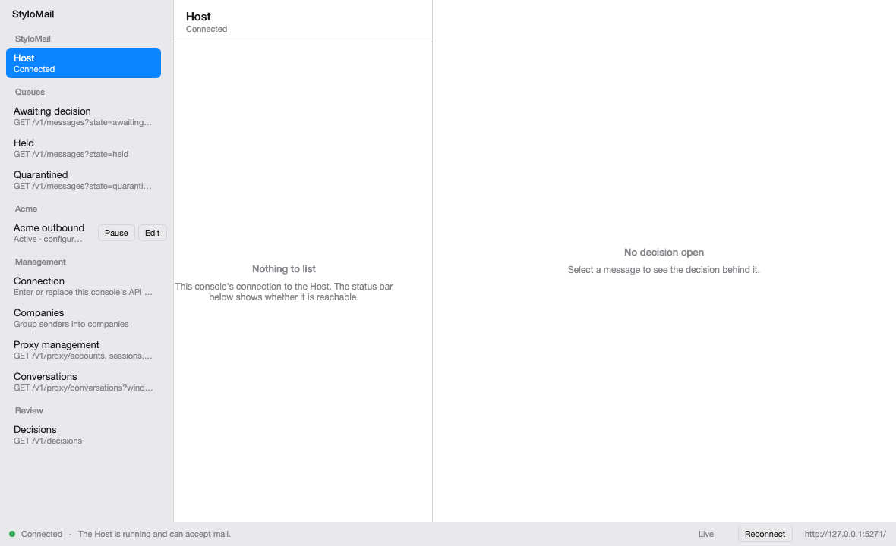
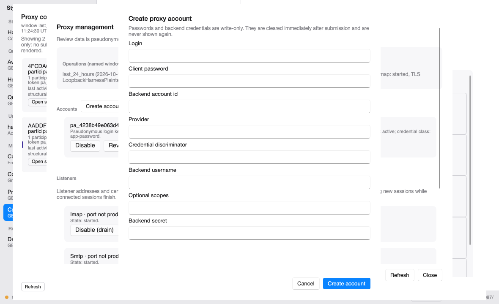
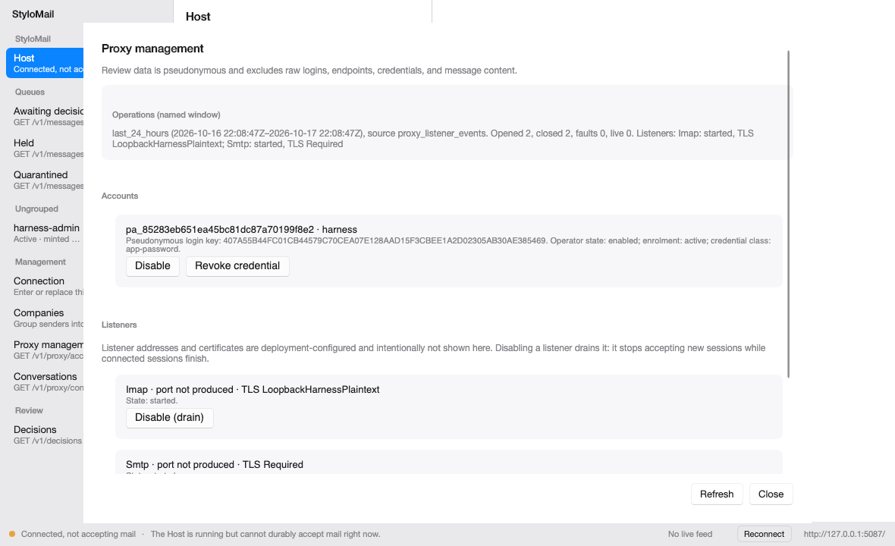
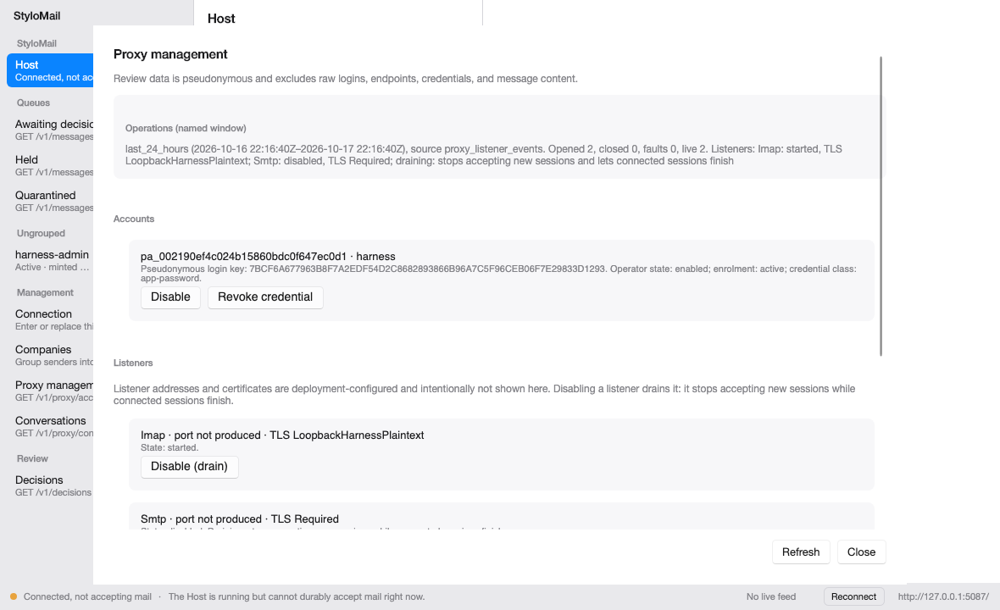
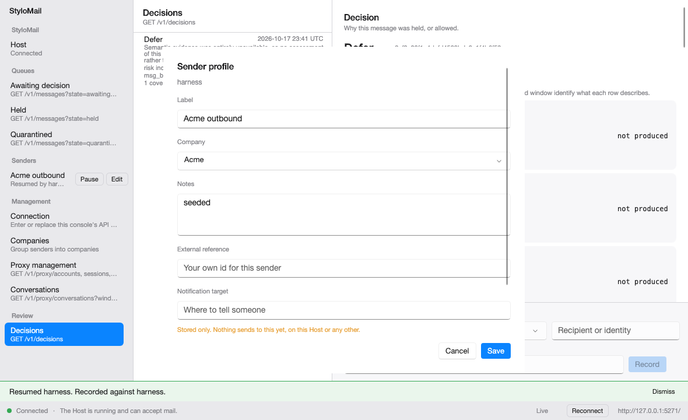
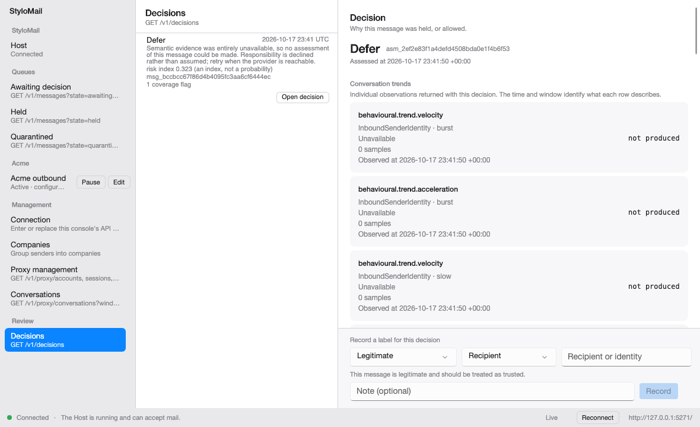
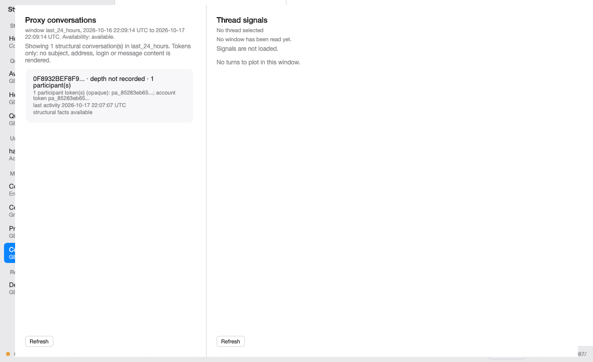
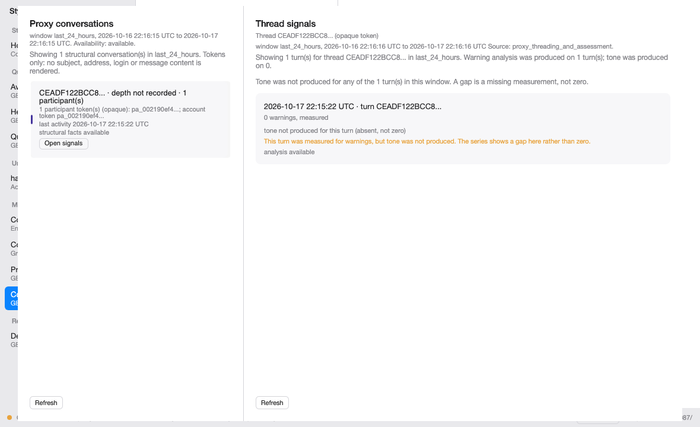
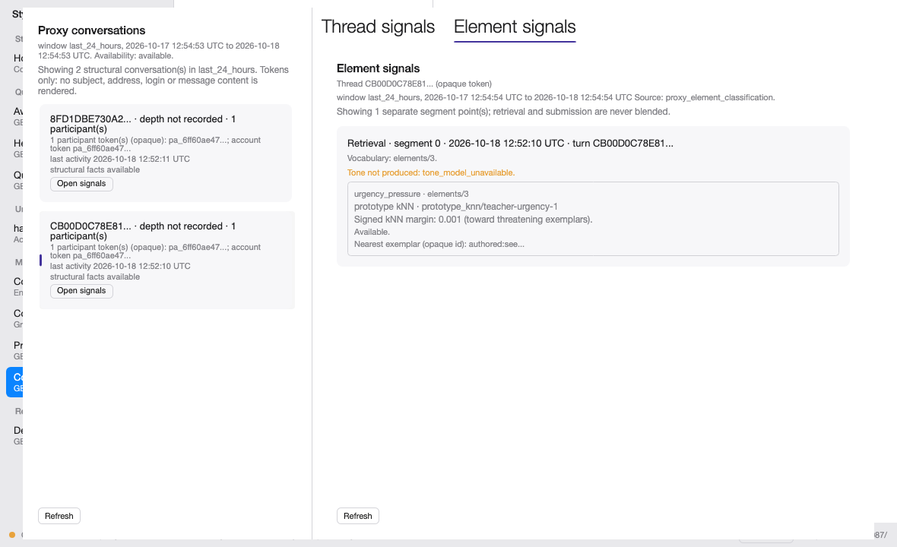
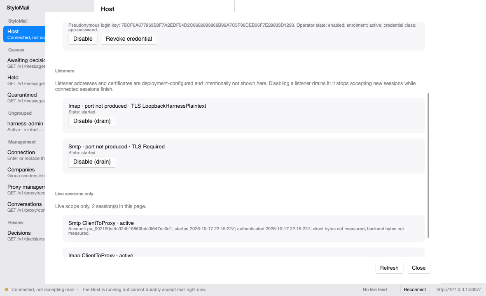

# StyloMail operator console: user manual

Draft of 17 October 2026.

This manual is written for the person who runs StyloMail and its client access proxy. It walks
through the Avalonia console screen by screen. It is a draft: eleven figures are captured from
verified runs, three more are covered by a frame already used, and the rest name the state they must
show and stay pending until a verified run produces them. No figure is a mockup, and no screen is described as available unless it is in the build.

Four conventions are used throughout:

- **Not available in this build** means the console does not offer the control yet. The manual says
  what exists instead, and does not describe the future control as though it were on screen.
- **Pending capture** means the screen exists and the image has been requested from the console
  owner. The run directory is recorded beside the figure when the bytes arrive.
- **Held** means a frame exists but is not usable for that figure, and the reason is stated. A held
  frame is never used as if it showed the state the caption names.
- **Blocked** means the state is not reachable yet in this build, and the reason is stated.

## 1. What the console is, and what it is not

The console is the management interface for StyloMail and for the client access proxy that runs
inside the Host process. It is one API client: one base address, one API key, tenant-scoped routes.
It keeps no local database and cannot act on a tenant it is not authorised for. Every action it
offers also exists as a Host route, so a headless deployment is not a second-class citizen.

It is **not** a mail reader. Reading a mailbox is the proxy's job, under its own credential model.
The console's scope is accounts, senders, conversations, decisions and sessions. Where a view in
that scope is not built, this manual says so rather than implying it.

That distinction is enforced by the PII rule, not by a setting:

- Ordinary traffic never shows message content, in a route, a view, an export or a log.
- Where content is shown at all, it is only for a message that trips a spam trigger, through the
  quarantine and review path. That access is recorded in the ledger. This build has no content
  viewer, so the rule is a boundary rather than a screen.
- Sender, respondent, conversation and drift views are aggregates over a named window. They say
  which window they were computed over, and an empty series is never presented as a measurement of
  zero.

The management surface has three layers, and the console keeps them visually distinct:

| Layer | What it is | Where it appears |
| --- | --- | --- |
| Transport facts | Sessions, volumes, listener state, faults | Proxy management, Operations |
| Derived conversation signals | Per-turn tone and warning observations, numeric and labelled | Decision pane observations; proxy conversation view (planned, not implemented) |
| Content | A message body, only on a trigger, audited | Not shown in this build; authorised only through the quarantine and review path |

A tone or warning series is derived evidence. It explains what the analysis saw. The policy engine
remains the only place an action is chosen, and seeing a conversation's derived signals never
exposes its content.

## 2. Start here

### 2.1 What you need

- A running StyloMail Host, and the address it is listening on.
- An API key minted for the tenant you are managing. The key carries the tenant; you never type a
  tenant id into the console.
- The privileges your work needs. Reading the management surface needs Review. Changing accounts,
  listeners or credentials needs Administer. The Host refuses an action you are not entitled to and
  names the refusal; the console shows the Host's own words rather than a generic failure.

The console holds exactly one credential: its API key. It is stored in the platform keychain, never
in a configuration file, never in a log, and it cannot be shown again after it is saved.

### 2.2 Open the console

From a source checkout:

```bash
dotnet run --project src/StyloMail.Desktop
```

The console starts on `http://127.0.0.1:8080`, the address `docs/running.md` documents. If your
deployment binds somewhere else, enter that address instead. Port 5000 is deliberately not the
default because macOS reserves it for AirPlay Receiver: it will answer, but it is not a StyloMail
Host, and the console distinguishes that case (section 6.2) instead of reporting a bad key.

### 2.3 Connect

Open **Connection** in the Management section of the left rail. Enter the Host address and the API
key, then choose **Save and connect**. The key is stored in the keychain. **Remove stored key**
clears it; nothing on screen can reveal it.

> **Figure M01 (pending capture).** The main window before a key is set, with the status
> **No API key set**. Requested from the console owner as M01. Run directory: pending.
>
> **Figure M03 (pending capture).** The Connection screen with a Host address, an empty key field and
> the never-shown-again note. Requested as M03. Run directory: pending. A partial frame exists
> (`12-connection.png` in the same run), but it shows a re-connection over an existing key with a
> documentation placeholder address, so it is not used for the strict M03 state.

### 2.4 Readiness is not reachability

The status bar answers two different questions. The left side says whether the console can reach
and use the Host. The feed text beside it says whether the screens are following the Host or are a
photograph of it.

| Status headline | What it means | What to do |
| --- | --- | --- |
| **Connected** | The Host is running and can accept mail. | Work normally. |
| **Connected, not accepting mail** | The Host answered, and is deliberately refusing mail. | Read the named failed checks below the status. This is a Host condition, not a key problem. |
| **No API key set** | This console holds no key. Nothing has been sent. | Enter a key in Connection. |
| **API key refused** | The Host rejected the stored key. | The key may have been rotated or revoked. Enter the current key. |
| **Cannot reach the Host** | Nothing answered. | Check the address and that the Host is running. |
| **This console and the Host disagree** | The Host sent something this build cannot read. | They are likely different versions. |
| **Something answered, but it is not a StyloMail Host** | That address replied without StyloMail's error format. | Check the port. Another service may be listening on it; on macOS, port 5000 is the usual one. |
| **The Host refused the request** | A refusal that is not about the key. | Read the error code and the Host's sentence. |

When the Host is up and not accepting mail, it names the checks it failed. The list sits on screen
rather than behind a banner, because the remedy differs per check. Unknown, empty and not-yet-read
are three different states and the console does not render them as one.



> **Figure M02.** The console on a live harness Host. Status **Connected** and feed **Live**. The
> company **Acme** contains the sender **Acme outbound**, shown as Active with Pause and Edit; the
> middle pane says **Nothing to list** for the selected Host item, and the right pane says **No
> decision open**. Captured from `ux-results/console-smoke`, scenario `console-smoke` (success, 106
> actions), host build `7e498edf538a` as reported by the console lane; this run's `result.json`
> does not stamp it. sha256
> `20d6c5bd66cd1199101bc8aec42dee1141d7c6e5966c5226ecbaff26fba53c10`.
>
> **Figure M04 (pending capture).** Status **Connected, not accepting mail** with the failed-checks
> list visible. Requested as M04. Run directory: pending.

### 2.5 The live feed is a second question

A console can be connected to a Host and no longer hearing from it. The feed headline is separate
from the connection status for exactly that reason.

| Feed headline | What it means |
| --- | --- |
| **Live** | The Host is pushing changes as they happen, and every screen is read back from it. |
| **No live feed** | This deployment does not offer one, or nothing answered at the feed address. Screens are still read from the Host when you open them. |
| **Live feed not authorised** | The Host would not open a feed for this console's key. Reviewing is the privilege the feed needs, and it is granted separately from sending. |
| **Live updates stopped** | The feed was connected and is not. What is on screen is what it last said, not what the Host says now. |
| **Live updates not started** | This console has not asked the Host for a feed yet. |

When the console has been live and has not re-read the visible surface since, the feed headline
carries **, screen may be out of date**. Open a destination again or choose **Reconnect**. Reconnect
uses the stored key, which is never shown, and re-reads every pane.

> **Figure M07 (pending capture).** **Live updates stopped** with the stale suffix, captured after a
> mid-run Host kill and before Reconnect. Requested as M07. Run directory: pending.
>
> **Figure M05 (pending capture).** Status **Cannot reach the Host**. Requested as M05.
> Run directory: pending.
>
> **Figure M06 (pending capture).** Status **Something answered, but it is not a StyloMail Host**,
> from the address-change run. Requested as M06. Run directory: pending.

### 2.6 A first session, in order

1. Start the Host and note the address it is listening on. `docs/running.md` covers starting it.
2. Open the console, choose **Connection**, and enter that address and an API key with the Review
   privilege. Save and connect.
3. Read the status bar. **Connected** and **Live** mean the console is following the Host. Any other
   pairing is diagnosed in sections 2.4 and 2.5 before you act on a queue.
4. Open **Awaiting decision**, **Held** or **Quarantined**. Each empty state says what its emptiness
   means; none of them means the Host is broken.
5. Open **Decisions**, choose a row, and use **Open decision** to read why the action was taken.
6. Open **Proxy management** to review accounts, listeners, live sessions and operations. Chapter 3
   states which of those you can change here and which belong to the deployment.
7. If a check fails, chapter 6 names the three failures that are easy to confuse and what the screen
   says for each.

## 3. Settings

### 3.1 The boundary: accounts are managed, listeners are deployed

The accounts surface is built against a frozen contract. It creates, enables, disables and revokes
**accounts**. It shows **listener state**: the protocol, the configured port and TLS policy, the
observed state, and any fault. It does not reconfigure a listener's bind address, port, TLS policy or
certificate.

The Host maps routes behind this surface. Four settings frames are now captured: M08 (operations,
accounts and the start of the listener list), M10 (a draining listener), M09 (live sessions) and M12
(the create-account form). The not-produced operations state is still pending verified capture
(M11), so no figure claims it.

That boundary is deliberate. Those values are deployment configuration. Changing a live listener's
binding at runtime can strand connected clients, and the API cannot undo it. The operator can see
what the deployment chose and whether it is working; changing it is a deployment action followed by
a restart, with the clients' connections in view.

| Setting | Where it is changed |
| --- | --- |
| Account enabled or disabled | Console |
| Account credential revoked | Console |
| Account created | Console |
| Listener enabled or disabled | Console |
| Listener bind address | Deployment |
| Listener port | Deployment |
| Listener TLS policy | Deployment |
| Listener certificate | Deployment |

The table says where each setting belongs, not what is clickable today. Bind address, port, TLS
policy and certificate are shown as state and are not editable from the console.

> **Figures captured, one pending.** M08, M10, M09 and M12 are captured and appear below. M11
> remains pending: the operations block in the available frames shows an available window, not the
> not-produced state. If a read fails, section 3.6 says what that looks like and why it is not an
> empty account list.

### 3.2 Accounts

An account is one proxied mailbox for one tenant. It is stored with:

- an opaque account id, generated by the Host;
- a tenant-keyed login key, a pseudonym. The console never shows the raw login;
- the provider id and the credential class;
- the enrolment state: active, revoked or unavailable;
- whether the account is enabled, and the timestamps of the change.

Enable and disable are operator states. They are not inferences about backend health: an enabled
account can still fail at the backend, and a disabled account is a decision you made.

The create form takes a login, a client password, a backend account id, a provider, a credential
discriminator, an optional backend username, optional scopes and the backend secret. Passwords and
backend credentials are write-only: they are cleared immediately after submission and are never
shown again.



> **Figure M12.** The **Create proxy account** form, unsubmitted, with its fields empty and the
> write-only note visible. Login, Client password, Backend account id, Provider, Credential
> discriminator, Backend username, Optional scopes and Backend secret are present, with Cancel and
> Create account. No account was created for this frame, so no returned id is shown and the account
> set was not mutated. Captured from
> `ux-results/console-external-host/m26-m12-20261018T112425Z-32636`, scenario
> `ux-scripts/console-m26-m12-capture.yaml` (13 of 13 actions passed), host build `f8c74d98f829`,
> sha256 `3282f6165beb888965dd3f9d30f075444e6d62f81852eece7e5c96a22bf060bc`.
>


> **Figure M08.** Proxy management on a live two-way harness Host. The Operations block names the
> `last_24_hours` window, its UTC bounds and its source. The Accounts block shows one enrolled,
> enabled account with an opaque id, a tenant-keyed login key, `active` enrolment, its credential
> class, and the **Disable** and **Revoke credential** controls. The Listeners block begins below it,
> with the IMAP listener started and the SMTP row cut by the viewport. The started IMAP listener
> shows **Disable (drain)**, and the section carries the drain-aware notice. The status bar reads
> **Connected, not accepting mail** because this harness Host runs with no assessor (`host.log`
> records `assessor_unavailable`), not because the proxy reads failed. Captured from
> `ux-results/console-external-host/20261017T220845Z-42900`, scenario
> `console-proxy-management-capture`, a real two-way harness Host. Host build id was not reported
> with this batch. sha256 `ced0c85c684e8f1132efc84b30e9087566f2bccb6b8207089360d2a92ca500a2`.
> The live sessions section is below this viewport; M09 captures it in a scrolled frame.

### 3.3 Listeners and TLS policy

The Listeners section names each listener in its own row, with its protocol, whether it is enabled,
its state, its TLS policy, a safe fault reason when it is faulted, and its enable or disable
control. The observed port is shown when the Host reports it; **port not produced** means unknown,
not port zero. The listener entry never carries the bind address, a certificate reference, an
identity, a command, a payload or a secret.

Listener state is one of:

| State | What it means |
| --- | --- |
| **started** | The listener is bound and accepting connections. |
| **stopping** | Disable has stopped new sessions and the drain is running. Existing sessions are reaching their bound. |
| **stopped** | The listener is configured but not running. |
| **faulted** | The listener could not run. The row names a safe reason, for example a certificate that is unavailable. |
| **not_produced** | The Host did not report listener state for this window. This is unknown, not stopped. |

TLS policy is explicit per protocol. For SMTP submission, a client-facing TLS terminator is required
before authentication: `AUTH` is neither advertised nor accepted until TLS is active. A deployment
that cannot provide it cannot host submission beyond a loopback harness. That is a prerequisite, not
a gap you can configure around in the console.

> **Figure M13.** The drain-aware control and its notice are visible in Figure M08: the started IMAP
> listener shows **Disable (drain)**, and the section says that disabling stops accepting new
> sessions while connected sessions finish. A disabled listener shows **Enable**. The Host answers a
> disable with 202 while the drain continues. No separate frame is used for this figure, so M13 is
> covered by M08 rather than duplicated.
>


> **Figure M10.** Operations and listeners with the SMTP listener draining. The Operations summary
> reads `Smtp: disabled, TLS Required; draining: stops accepting new sessions and lets connected
> sessions finish`, with opened 2, closed 0, faults 0 and live 2 over `last_24_hours`. The Listeners
> list shows the IMAP listener started with **Disable (drain)**; the SMTP listener's own row is
> clipped at the viewport, so the drain state is read from the Operations summary rather than from
> that row. Captured from `ux-results/console-external-host/20261017T221638Z-47600`, scenario
> `console-listener-drain-capture`, host build `60716c32c85a`, sha256
> `439d8791039da9ea7936d694f6fcb2eb416cec37d8009128f299696954960130`.
>
> **Figure M14 (pending capture).** A faulted listener with its reason legible. Requested as M14.
> Run directory: pending.

### 3.4 Credentials and revocation

The backend credential is stored protected, and the console never renders it. Under the contract,
revoking it marks the stored credential revoked so it can no longer be resolved for authentication.
The account row shows the revocation, and re-enrolling the account is required before it can
authenticate again.

What revocation does not do in this build: it does not terminate a session that is already
connected. Neither does disabling the account. Both stop new authentications. The drain-aware
listener disable is the deployment-level control for connected clients when it lands; that is why
the manual states the difference rather than implying that revoking a credential disconnects
anybody.

> **Not available in this build.** The revoke route is mapped; the control is not in the client yet
> (M08). When it lands, the console will show the account's revocation and the Host's answer. A
> repeated revoke is idempotent and keeps the first revocation time.

### 3.5 Operations and the named window

Operations is a named-window read, not a live counter. The frozen contract accepts one window,
`last_24_hours`. When the read succeeds, the card echoes the window name and its UTC start and end,
so a figure is never read without knowing what it covers. It also names its provenance,
`proxy_listener_events`.

The counters are opened, closed, faulted and live sessions. Every counter is nullable. When the
window's telemetry was not produced, the card says so and says the counters are unknown, not zero.
An empty list is not a zero-session claim.

> **Figure M11 (pending capture).** The Operations card in the not-produced state, with the
> unknown-not-zero wording visible. The first batch's `M11-operations.png` is byte-identical to M08,
> and its operations block shows an available window, not the not-produced state, so it is not used
> for this figure. Run directory: pending.

### 3.6 When the settings screen cannot read its data

If the management routes are unavailable, the screen replaces its status line with the reason:
**Could not read proxy management data**, followed by the Host's code or detail. The account and
session lists are then empty, and that empty state is not evidence that the tenant has no accounts.
It is a failed read.

If you see this, treat it as a connectivity or version problem, not as an account population of
zero. The read did not happen, so the screen has nothing to report about accounts.

## 4. Review

### 4.1 Queues

The Queues section lists what is waiting for attention, by disposition:

| Destination | What it lists |
| --- | --- |
| **Awaiting decision** | Messages accepted and not yet decided on. Mail already in normal delivery is not enumerable here. |
| **Held** | Messages retained to a bounded re-evaluation deadline. That deadline is an observation window, not a soft reject. |
| **Quarantined** | Messages policy placed in quarantine. Releasing one is audited and requires the review privilege. |

Each destination's empty state is written for that destination, for example **Nothing is held**
with the explanation that a held message is retained to a bounded deadline. An empty list here means
nothing is waiting, not that the Host is broken. A listing the Host had to drop rows out of is shown
as a warning beside the rows, not as an empty page.

### 4.2 Senders and companies

Senders are the authenticated principals. The left rail groups them by company. Selecting a sender
opens a profile with its label, company, notes, external reference, notification target and posture.

- **Pause** and **Resume** change the principal's control state. The row keeps the audit trail, so a
  sender that was paused and lifted is distinguishable from one nobody has touched. That is the
  answer to "why was this account stopped for six hours", asked after the pause is gone.
- **Edit** changes the operator's description of the principal, not how mail is judged.
- **Notification target** is stored only. Nothing sends to it yet, on this Host or any other.
- **Posture** is stored and shown. No part of the pipeline reads it yet, so it records a stance
  rather than enforcing one.

A company is operator-side grouping only. Nothing in the assessment pipeline reads it. Two senders
with no company are two different cases: a null company means nobody has described the sender, and
an id with no matching company means somebody filed it under a company since deleted. The console
labels them differently because the remedies differ.

> **Figure M15.** Covered by Figure M02, which shows the sender rail grouped by company: the heading
> **Acme** with the sender **Acme outbound** beneath it, its Active state, and its Pause and Edit
> controls. No separate frame is used, so the same run and build apply.
>


> **Figure M16.** The Sender profile dialog for **Acme outbound**, with Label, Company **Acme**,
> Notes, External reference and Notification target visible, and the stored-only note under the
> notification target. The sender rail behind it shows the same sender's **Pause** and **Edit**
> controls. Posture is not visible in this frame, and the dialog itself shows Cancel and Save rather
> than Pause or Resume. Captured from `ux-results/console-smoke`, scenario `console-smoke` (success,
> 106 actions), host build `7e498edf538a` as reported by the console lane; this run's `result.json`
> does not stamp it. sha256
> `c4ceb77729e4a6be634e95995c252fadfd995cf45af49bb32bef7d81e7cc8c11`.

### 4.3 Respondents

> **Not available in this build.** There is no respondents screen, and none is currently planned.
> The proxy conversation surface groups turns by threading headers and carries pseudonymous
> participant tokens, so a conversation can be listed without exposing an address. That is not a
> respondent directory, and the conversation view is planned but not implemented (section 4.5).
>
> Assessments themselves carry no conversation identifiers for email, so the decision ledger's
> conversation history remains Slack-only. For email, a decision-level conversation view is not
> available, and an empty view would not mean nobody replied.

### 4.4 Decisions

A decision is written when a message is assessed. It records the action policy chose, the evidence it
saw with each observation's origin and window, the ordered reasons, the coverage it achieved, and the
versions that produced it. The console reads that record; it does not re-run policy or recompute the
index.

Open **Decisions** in the Review section. The ledger lists recorded assessments. A row shows the
action, the assessment time and the policy's headline reason; the row's **Open decision** control
opens the full decision over its own route, because a summary cannot carry the evidence it would
have to truncate.

The empty ledger says **No decisions are recorded**, with the reason: a decision is written when a
message is assessed, so an empty ledger means nothing has been assessed on this Host yet. It is not
a Host failure.

The decision pane answers "why was this message held, or allowed":

- the action, assessment id and assessment time;
- the **risk index**, labelled as an index and not a probability;
- **coverage**, with the denominator stated even when it is absent. Nothing reduced the analysis
  means the whole message was examined; a reduction names what was not;
- **Why**, the ordered reasons with the evidence that produced each one, including origin, scope,
  value, availability and any reason the evidence was missing;
- **Dimensions**, with each dimension's score and contribution to the index;
- **Versions**, naming the policy and classifier versions that produced the decision;
- **Semantic cache**, stating whether the semantic answer came from a cache.

Two labels matter when they appear:

- **Would have been X** means the decision was taken in shadow mode. It records what policy would
  have done; it is not the action taken.
- **Seen after delivery** means the platform had already delivered the message. Every action
  available on that decision is post-hoc, and nothing in it could have stopped the message.

> **Figure M17 (pending capture).** The empty Decisions ledger. Requested as M17.
> Run directory: pending.
>


> **Figure M18.** A real **Defer** decision with its assessment time, shown as an
> unavailable-evidence decision. The ledger row carries the headline reason that semantic evidence
> was entirely unavailable, so no assessment could be made and responsibility was declined; it also
> gives risk index 0.323 (an index, not a probability) and 1 coverage flag. The pane shows the
> action, the time and the Conversation trends. The ordered **Why** list is not visible in this
> frame, so this figure does not illustrate available evidence. Captured from
> `ux-results/console-smoke`, scenario `console-smoke` (success, 106 actions), host build
> `7e498edf538a` as reported by the console lane; this run's `result.json` does not stamp it. sha256
> `860bb17ce3e12f07ff00289b0106e98bfc9c24f1bf2f1bd570cd9dc1e7e0399b`.
>


> **Figure M19.** A real **Defer** decision whose semantic evidence was unavailable. The ledger row
> says semantic evidence was entirely unavailable, so no assessment could be made and
> responsibility is declined rather than assumed; it gives risk index 0.323 and 1 coverage flag. The
> Conversation trends panel shows three individual observations, each **Unavailable**, each **0
> samples**, each **not produced**, with its observed time. A missing measurement is stated, not
> drawn as zero. Captured from `ux-results/console-smoke`, scenario `console-smoke` (success, 106
> actions), host build `7e498edf538a` as reported by the console lane; this run's `result.json` does
> not stamp it. sha256
> `58dfacd242f46015d68c65495782257d3bd5cf8e608cf6abc8ea992818946729`.

### 4.5 Conversation signals: tone and warnings

The proxy defines a conversation surface, grouped from transport facts rather than content. The
console renders the conversation list, and selecting a thread loads its signals. These subsections
record what each shows; the list and a selected-thread mixed state are captured below.

The proxy groups turns into threads by threading headers: `Message-ID`, `In-Reply-To` and
`References`, read from a bounded header block. It never groups by subject or body, because a
subject line is content and routinely carries names. A message with no threading header is its own
thread of depth one.

The conversation list shows one row per thread over the named window:

- the thread token, an opaque identifier;
- the account token, an opaque account identifier;
- the pseudonymous participant tokens;
- the reference depth;
- the last activity time;
- the row's availability.

No address, backend identity or subject appears. If threading telemetry was not produced, the
answer is `not_produced` with no rows. An available empty list is a readable window with no threads.
The two are different answers and the list must not render them as one.



> **Figure M21a.** Proxy conversations over `last_24_hours`, with the window's UTC bounds and
> `Availability: available`. One structural conversation is listed: an opaque thread token, its
> account token, one opaque participant token, depth shown as **not recorded**, last activity, and
> structural facts available. No subject, address, login or message content is rendered. The Thread
> signals pane on the right is unselected: no window has been read, signals are not loaded, and
> there are no turns to plot. This frame does not show the signals series; M21 is captured
> separately below. Captured from
> `ux-results/console-external-host/20261017T220912Z-43052`, scenario `console-conversation-capture`,
> a real two-way harness Host. Host build id was not reported with this batch. sha256
> `270978f8b863d0a84f3eafccbd37efae256820e06f2e4b0c8b3250a06820d7d3`.
>
> Selecting a thread now loads its signals; M21 below shows a selected thread with warnings measured
> at 0 and tone not produced. M22, the assessed conversation history, remains pending.

The per-thread signals view reads `GET /v1/proxy/conversations/{threadToken}/signals` over a named
window. The only accepted window is `last_24_hours`. The response echoes its UTC start and end and
names its provenance, `proxy_threading_and_assessment`.

#### What the view will show when signals exist

- one point per turn, ordered by observation time, forming the series;
- the tone score for that turn, or an explicit not-produced state;
- warning markers, each a named kind from a fixed vocabulary;
- the marker count, where 0 on an available point is a measured clean;
- the dimension ids the point measured;
- an availability state for every point, and for a not-produced point its reason: `None`,
  `NoAnalyserConfigured`, `UnreadableMessage` or `UnsupportedContent`;
- the point's turn token, rather than a message id.

The series is derived, not content. An available point carries a number or a label from a fixed
vocabulary; a not-produced point carries its reason instead. No body, subject, header value, address
or free text appears in the series, a tooltip or an export. The view states its named window and its
provenance, does not interpolate between points, and does not compute a conversation total: each
point stays with its turn.

A produced value of **0** is a measured clean. It is a real reading that the turn scored calm, and it
must look different from a point that was never measured. A **NotProduced** point is unmeasured and
says why. The two are not the same fact and the view may not draw them alike.

#### What the data shows today

Threading facts exist: turns are recorded from threading headers. Warning analysis can be linked:
when the Host has a MIME analyser, it reads a bounded copy and records a closed warning outcome per
turn; when it does not, the point says `NoAnalyserConfigured`. Tone is not linked to a semantic
provider on this tap. A turn can therefore carry two different absences and one measured zero:

- **0 warnings, measured**: the warning analysis ran and found none. This is a measured clean.
- **tone not produced**: no tone measurement exists for that turn. This is a gap, not zero.
- **not produced with a reason**: the warning analysis did not run, and the point names why.

The captured frame below is the mixed case: warnings measured at 0, tone not produced. The view
states both explicitly, draws no line through the gap, and never presents a missing tone as 0.



> **Figure M21.** A selected conversation thread on the Thread signals pane. The window is
> `last_24_hours` with its UTC bounds, and the source is `proxy_threading_and_assessment`. The header
> says warning analysis was produced on 1 turn and tone on 0. The single point reads **0 warnings,
> measured** and **tone not produced for this turn (absent, not zero)**, with the copy that the turn
> was measured for warnings but tone was not produced, so the series shows a gap here rather than
> zero. The warning zero is a measured clean; the tone is a gap. Captured from
> `ux-results/console-external-host/20261017T221612Z-47466`; the file is named
> `M22-thread-signals.png` and shows the signals view, so it is used here as M21. Scenario
> `console-conversation-signals-capture`, host build `60716c32c85a`, sha256
> `a28e2f9cdfb0fdae14212f4d784f6f7f347bebbae9af36829b2437fd38779ab0`.
>
> **Figure M21b (pending capture).** A measured tone series, when a local semantic measurement is
> linked to the tap. Warnings can already be measured; tone cannot yet. Run directory: pending.

#### The decision pane's observation rows

Separately from the per-thread view, the decision pane's **Conversation trends** panel lists
individual observations returned with the selected decision. Each row carries:

- the signal id, for example a named dimension or a drift signal;
- its scope and the named window the value was computed over;
- its value, or **Unavailable** when no value was produced;
- its sample support, where **0 samples** is a separate observation from an unavailable value;
- the observation time, and the assessment time above the list.

A few rules follow from the spec and are visible in the panel's wording:

- **Derived signals, not content.** A row is a numeric score or a label from a fixed vocabulary. No
  free text from a message reaches a chart, a tooltip or an export. Seeing these signals never
  exposes a conversation's content.
- **No history totals.** Each observation stays with its assessment. The console does not combine
  assessments into a history total, and a series is not a transcript.
- **A warning is evidence, not a verdict.** The policy engine remains the only place an action is
  chosen.
- **Not produced is a state.** No local provider, an outage, or a message the provider could not
  read produces `not_produced` for that turn. It is not zero, and a series must not draw it as a
  straight line.

> **Not available in this build.** This panel renders the individual observations as cards. It is
> not the per-thread graph in the previous subsection. Until the graph exists, read the cards: a
> missing value is stated, not drawn.
>
> **Figure M20.** Covered by Figure M19, which shows three real Host observation rows in the
> Conversation trends panel: `behavioural.trend.velocity` for the burst window,
> `behavioural.trend.acceleration` for the burst window, and `behavioural.trend.velocity` for the
> slow window. Each is **Unavailable**, **0 samples** and **not produced**, with the assessment time
> above them. No separate frame is used, so the same run and build apply.

#### Assessed conversation history

For a decision that carries workspace and channel keys, **Assessed conversation history** reads
original records for that conversation. **Load recent assessed records** fetches the first page and
**Load older assessed records** follows the Host's opaque cursor. Each record keeps its own
assessment time, action and observation rows. For email decisions, which have no such keys, the pane
says so rather than offering a guessed conversation.

> **Figure M22 (pending capture).** Assessed conversation history after **Load older** has appended
> the second page. Requested as M22. Run directory: pending.

### 4.6 Element signals

The element layer is a second, content-free view of a proxied submission. It is designed to split
the message into bounded segments and score the measured element, `urgency_pressure`, per segment at
a loopback embedding service. The console renders it as the **Element signals** tab of the
conversation view; Figure M26 is pending a retained capture. The Host route is
`GET /v1/proxy/conversations/{threadToken}/elements?window=last_24_hours`, with provenance
`proxy_element_classification`. It is a sibling of the tone and warning series, not a replacement
for either.

#### What is scored

The measured vocabulary is `elements/3`, and it contains one element:

| Element | What the name means |
| --- | --- |
| `urgency_pressure` | A segment that presses for immediate action or a deadline. |

The other names are not part of the measured vocabulary. They are recorded here so a reader who
meets an older stored row or an older report knows what it was, not so they can be read as current
measurements.

| Name | Status | Reason |
| --- | --- | --- |
| `credential_request` | Research item, not in `elements/3` | Failed the pre-registered 150-row check: union agreement 0.413, with 44 teacher-only labels against 0 in the other direction. The failure is one-sided, not a threshold question. It needs a definition and reviewed, quote-verified positives. |
| `threat` | Research item, not in `elements/3` | Cannot be labelled reproducibly: a 5-row union in the 60-row check with a teacher-heavy direction, 11 teacher-only against 2 verifier-only on the same-model pair, and 8 training positives. It needs a reviewed, quote-verified positive set before it can re-enter. |
| `impersonated_greeting` | Removed at `elements/2` | The teacher labelled the act on rows where it was not present; a different lineage could not reproduce those labels. |
| `attachment_lure` | Removed at `elements/2` | Removed for the same reproducibility failure as `impersonated_greeting`. |

The vocabulary is versioned `elements/3`. Adding or renaming an element is a version bump, not a
quiet extra name. Every score carries the vocabulary version it was produced under. The element
vocabulary is not the warning-marker vocabulary: `link_domain_mismatch` and the other MIME findings
are warning markers in a separate closed set, and moving a name from one set to the other is a
version bump rather than an edit.

#### What a score means depends on its scorer

| Scorer | Version | What the number is |
| --- | --- | --- |
| `prototype_knn` | `prototype_knn/corpus-1` | A signed margin: the nearest threatening exemplar's cosine similarity minus the nearest benign exemplar's. Positive is closer to the threatening set, negative is closer to the benign set, zero is equidistant. It is not a probability. |
| `linear_probe` | `linear_probe/corpus-1` | A logistic probability in [0, 1]. It is not a margin. |

The scorer and its version travel with every score, because the two numbers answer different
questions and must never be blended. A kNN margin must not be clamped into [0, 1] or read as a
percentage. A negative margin is a measurement toward the benign exemplars, not a missing value. A
`NearestExemplarId` is an opaque identifier such as `ex:urgency_pressure:0007`; it is not a
message fragment, an address or a subject. The console panel prints a signed kNN margin with its
direction, never a percentage.

#### Availability is per element

Each element on each segment is either available with a score, or not produced with a reason. The
reason is per element, so one element can be not produced while another on the same segment is
scored. In `elements/3` only `urgency_pressure` is measured, so in practice the reason describes
that element.

| Reason group | Wire names | What it means |
| --- | --- | --- |
| Artefact | `no_exemplars`, `probe_not_trained`, `artefact_missing` | The deployed scorer lacks what that element needs. Fix the artefact, or accept that the element is unscored. |
| Transport or contract | `unauthorized`, `service_unavailable`, `timed_out`, `circuit_open`, `model_tag_mismatch`, `dimension_mismatch`, `prefix_version_mismatch`, `unsupported_dtype`, `contract_violation` | The embedding service is unavailable, unauthorised, or answering a different model than the stored points expect. |
| Segmentation | `too_many_segments`, `segment_too_long`, `empty_segment` | The bounded segmenter dropped or refused a segment. |

A not-produced element is never zero and never a clean result. A margin of **0** is a measured value:
the segment sits equidistant from the two exemplar sets, which is not the same as no analysis.

#### Segments and ordinals

The intended design splits a submission into zero-based contiguous ordinals, at most 32 segments
and at most 6000 bytes each. The layer records the applied bounds, the ordinals actually analysed,
and whether any segment was dropped. The element series groups scores by turn token and ordinal, so
available and not-produced entries for one segment sit in one list; it does not invent an entry the
Host did not record. The independent review found that the current implementation does not meet this
design; see the provisional evidence note below.

#### Both directions in one harness run

Element points have been recorded in both directions in a single harness run, not production.
`.styloagent/artifacts/proxy-e2e-20261017T234655Z` contains `retrieval-analysis.json` and
`submission-analysis.json`; each reports availability Available, reason None, `segmentCount: 1`
and `elementPointCount: 5`, produced under the vocabulary that was current at the time. The measured
vocabulary is now `elements/3` with one element, so a current run returns `urgency_pressure` only;
the direction proof stands, while the point count is historical. The same
run's `client-transcript.txt` records the IMAP client fetching
one 168-byte body, the SMTP client completing STARTTLS, authenticating and submitting one message,
and `IMAP+SMTP PASS`. `sessions-smtp-live.json` records authenticated Imap and Smtp sessions on the
same opaque account `pa_f1cd145597b34ed4bec9c2a37866a978`. Host build `cf6faa6d7f69`.

> **Provisional evidence.** The independent review found a segmentation defect in the current
> implementation. The orchestrator decodes the entire raw wire message as UTF-8, headers and
> transfer encoding included, and splits only on LF LF, so a normal CRLF message becomes one
> 6000-byte fragment and later body text is never analysed while segment coverage is still
> reported. The points in the run above were produced, but they describe the analysed segments, not
> yet the whole message; the analysed fragment may be header-laden rather than the body. Treat this
> evidence as provisional until the segmenter is repaired and a new harness run exists.

#### Calibration and the false-positive budget

The scorer aims at a one percent false-positive rate among scorers whose recall is at least 0.85.
That budget is **not met and cannot yet be resolved**. Held-out negatives for the measured element
are below the 100 needed to resolve a one percent rate, so the scoring artefact marks the element
`fpr_budget_resolvable: false`. An element score is evidence, not a calibrated alarm. A quoted
false-positive rate must name the element and its hard-negative count.

#### Tone is a separate series

The element response carries a sibling `Tone` block with its own vocabulary (`goemotions/1`), its
own model tag, its own availability and reason, and its top labels. **Tone is not produced in this
build**: its reason is `tone_model_unavailable` and its model tag is null, because no tone model is
served on this deployment. A placeholder tag would invite a comparison against a model that is not
producing the series. A tone label is not an element score, and the two series must not be combined
or drawn on one axis. M21 is the tone and warning figure; M26 is the element figure, and they stay
distinct.

#### Privacy

The element layer is content-free by construction. Segments are examined by a local embedding
service, and a stored point carries the element name, score, availability, reason and opaque exemplar
id, together with its provenance: scorer, scorer version, vocabulary version, model tag, dimension,
ordinal and time. It carries no segment text, digest, subject, address or message body, and none of
those are logged. When element analysis is enabled, the Host refuses to start if the embedding
endpoint is not a loopback address, because the point of this path is that message segments never
leave the machine.

#### How to read it

- An element score is a lexical signal about a segment, not a verdict. Policy remains the only place
  an action is chosen.
- Compare scores only under the same scorer, scorer version and vocabulary version. A change in any
  of them makes two numbers non-comparable.
- A negative kNN margin is evidence toward benign exemplars, not absence of evidence.
- Use the reason to separate a deployment gap (artefact or service) from an input gap
  (segmentation).
- Do not read the element series as a transcript. It is vocabulary names per segment, never text.



> **Figure M26.** The **Element signals** tab for a selected opaque thread. The window is
> `last_24_hours` with its UTC bounds and source `proxy_element_classification`; the point is
> **Retrieval · segment 0** with its UTC time and opaque turn token. The vocabulary is `elements/3`
> and exactly one card appears, `urgency_pressure`, because that is the measured element; the
> `credential_request` and `threat` research items are not in this vocabulary. The card shows the
> scorer `prototype kNN · prototype_knn/teacher-urgency-1`, **Available**, a signed margin of
> **+0.001 (toward threatening exemplars)**, and a shortened opaque exemplar. A margin of +0.001 is
> near zero and is weak evidence on this message. The sibling tone line reads **Tone not produced:
> tone_model_unavailable**, with no zero implied. Segmentation remains provisional: the card
> describes the analysed segment, not whole-message analysis. Captured from
> `ux-results/console-external-host/20261018T125450Z-68237`, scenario
> `console-m26-elements3-capture` (12 of 12 actions passed), host build `09bed8235ebd`, sha256
> `b9d1acf5fe15911c6b2fc12a1ad999643677e65cacec08ab024ea4ff1a199448`.

### 4.7 Quarantine and release

Open **Quarantined**. The listing shows the messages policy placed there. Selecting one offers
**Release**, and only a message actually held in quarantine can be released.

Release is not a single click. A confirmation carries a reason, and that reason is recorded in the
audit trail with the actor. After the Host answers, the result bar reports the queue id and the
operator the release was recorded against. A message that was already released is a success, not an
error: the result says it was already released and still names the actor.

This build does not display message content at all. The only authorised path for content is a
message that trips a spam trigger, through the quarantine and review path, and access there would be
recorded in the ledger. No such content view exists on this screen today, so this manual does not
illustrate one. The figures do not show a body: a screenshot with message content in it would not be
usable.

> **Figure M23 (pending capture).** The Quarantined listing with one item and no body content in
> the frame. Requested as M23. Run directory: pending.
>
> **Figure M24 (pending capture).** The release confirmation with the reason field. Requested as
> M24. Run directory: pending.
>
> **Figure M25 (pending capture).** The result bar after a release, with the row gone. Requested as
> M25. Run directory: pending.

## 5. Operations

### 5.1 Live sessions

Live sessions are reviewed in **Proxy management**, under **Live sessions only**. The listing is
captured in Figure M09. The first batch's file placed this section below the viewport and is not
used; the accepted frame is scrolled to the section. The contract and the states it distinguishes
are described here. Each row names the protocol, the direction, and the outcome or active state. It
carries the account id, start and authentication times, client and backend byte counts where the
Host reports them, and a safe reason when the session was bounded.

Attribution is measured, not prospective. In the committed proof (`b35a2af`), recorded at
`.styloagent/artifacts/proxy-e2e-20261017T203617Z`, an IMAP session
`ps_00028a4105d74e0485f689030f66e578` and an SMTP session
`ps_c3d2c6f59cd947b2abac480ef95891eb` both carry account
`pa_08df84b9f29c47f3bda8a10b20a5756e`. The same artifact records that the IMAP client
authenticated and listed INBOX, and that the SMTP client completed STARTTLS, authenticated and
submitted one message (`client-transcript.txt`). That is the two-way proof: one account, two
protocols, both authenticated and attributed to that account. The identifiers above are from that
artifact, not from a screenshot.

Direction is the transport leg the row describes, `ClientToProxy` or `ProxyToBackend`. It is not a
retrieval-versus-submission label. The two-way distinction this chapter relies on is the protocol
row, IMAP for retrieval and SMTP for submission, together with the shared account id.

A session that has not authenticated carries no account id. The screen must show that as
unattributed, not as a blank field or a null-looking value that could be read as an account. The
listing is live scope only and makes no promise of session history.

Byte counts are shown where the Host reports them. In the artifact's live session rows the byte
fields are null while the session is open; a null is not zero, and the same rule applies here as
everywhere else in this manual.

An empty list has two meanings, and the screen distinguishes them:

- **Live scope only. N session(s) in this page.** The read succeeded and the page is empty.
- **Live-session telemetry was not produced for this window; an empty list is not a zero-session
  claim.** The read did not produce telemetry.



> **Figure M09.** Proxy management scrolled to the live sessions section on a live two-way harness
> Host. The section reports **Live scope only. 2 session(s) in this page.** The SMTP row is fully
> visible: `Smtp ClientToProxy · active`, its opaque account id, start and authentication times, and
> both byte counts **not measured**. The IMAP row's title is visible at the bottom and its detail is
> clipped by the viewport, so this frame does not show the IMAP account. The run artifact at
> `.styloagent/artifacts/proxy-e2e-20261017T221516Z/sessions-keepalive-live.json` records both
> sessions on the same account, and `client-transcript.txt` records that the IMAP client
> authenticated and listed INBOX while the SMTP client completed STARTTLS and submitted one
> message. Captured from
> `ux-results/console-external-host/20261017T221548Z-47299`, scenario `console-sessions-capture`,
> host build `60716c32c85a`, sha256
> `7b272aefffe27e40a7e167a6b69b645fd5e9f56e3fcadbf94891f6ade5a2af9c`.

### 5.2 Volumes and counters

Opened, closed, faulted and live counts come from the Operations card over `last_24_hours`. They
are nullable, and the card names the window and the provenance. Read them with the window, not as
totals.

### 5.3 Faults

A listener fault is shown with the listener's entry, with a safe reason and safe detail. A session
that was bounded carries its safe reason on the session row. Both are transport facts: they say what the proxy
observed, and neither exposes an endpoint, a credential or content.

A listener fault is not a verdict about the mail. It is an operational state for you to act on, for
example TLS material that is unavailable or a listener that could not bind. A session's bound reason
is separate: it says why that session stopped, which can be a backend failure. The deployment owns
the remedy for a listener fault.

## 6. Troubleshooting

### 6.1 Nothing answered: **Cannot reach the Host**

Nothing is listening at the address. Check the address, then that the Host process is running.
This is distinct from a Host that answered and refused. The console starts on the documented
address, 8080; if your deployment binds elsewhere, enter that address.

### 6.2 Something answered, and it is not StyloMail

If the address replied without StyloMail's error format, the status says **Something answered, but
it is not a StyloMail Host**. The usual cause on macOS is port 5000, which AirPlay Receiver owns.
The console no longer defaults there, so this appears only if that address was entered or stored
from an earlier build. Change the port to the Host's. Do not rotate the API key for this symptom:
nothing reached StyloMail.

Two neighbouring failures look similar and are not the same:

- **API key refused** means the Host rejected the stored key. The key may have been rotated or
  revoked. Enter the current key.
- **The Host refused the request** means a refusal that is not about the key. The status carries
  the Host's error code and sentence. Read them; the code names the rule.

### 6.3 The Host is up and refusing mail

The status reads **Connected, not accepting mail**, and the failed checks are listed on screen. The
console is connected: re-entering the key or changing the address will not help. Treat each named
check as the work item. The common example is **assessor_unavailable**: the Host was composed with
no assessor, so it cannot decide what it cannot assess. The same word appears on the assessment
routes' 503, so one condition has one name. A Host configuration state is not a console fault.

### 6.4 Four states that get confused: zero, not produced, unavailable, empty

This is the failure most likely to be misread, so it is stated in every place it can occur. Read the
state word, not the blank space beside it.

| State | What it means | Where you see it |
| --- | --- | --- |
| **Measured zero** | A measurement was made and the answer is zero, so a score of 0 is a measured clean. | Counters; a tone or dimension score whose availability is stated as available. |
| **not produced** | The measurement was never made, or the telemetry was unavailable. The answer is unknown, not zero. | Operations counters, live sessions, signal points. |
| **Unavailable** | A row exists but no value could be produced for it. At row level this is the same absence as not produced, and the value may read **not produced**. It is not a score of zero. | Decision evidence, conversation trends. |
| **Empty** | The read succeeded and returned no items. This is a complete answer, not an unknown. | A queue, an account list, a page of live sessions. |

The console does not collapse these into one. **0 samples** is a further separate observation: it
says how much support a value had, which is not the same question as whether a value exists.

An empty page, an unavailable value and a measured zero are three different facts, and a
not-produced point on a series is a fourth. None of them is evidence about the mail itself.

### 6.5 Where to look next

`docs/running.md` covers starting the Host, its configuration and its health checks. A readiness
failure is a Host condition and is diagnosed there. This manual covers what the console shows you
and what each state means.

## 7. Figure provenance

Every figure in this manual comes from a verified console run owned by the console lane. The run
directory is recorded here and beside the figure. A capture from harness traffic says so. A capture
from a fixture says so, and keeps its fixture banner visible. A tone or warning figure is derived
signals, not message content, and its caption says that.

| Figure | State | Run directory | Status |
| --- | --- | --- | --- |
| M01 | No API key set | pending | requested |
| M02 | Connected and live | ux-results/console-smoke | captured; build 7e498edf538a reported, not stamped; sha256 20d6c5bd… |
| M03 | Connection screen | pending | requested; 12-connection is partial (existing key, placeholder address) and not used |
| M04 | Connected, not accepting mail | pending | requested |
| M05 | Cannot reach the Host | pending | requested |
| M06 | Not a StyloMail Host | pending | requested |
| M07 | Live updates stopped | pending | requested |
| M08 | Proxy management, accounts and boundary | ux-results/console-external-host/20261017T220845Z-42900 | captured; sha256 ced0c85c…; host build id not reported |
| M09 | Live IMAP and SMTP sessions | ux-results/console-external-host/20261017T221548Z-47299 | captured; build 60716c32c85a; sha256 7b272ae…; IMAP row clipped, same account in the artifact |
| M10 | Listener draining | ux-results/console-external-host/20261017T221638Z-47600 | captured; build 60716c32c85a; sha256 439d879…; drain shown in the operations summary |
| M11 | Operations not produced | pending | blocked: only an available operations window was captured |
| M12 | Create account form | ux-results/console-external-host/m26-m12-20261018T112425Z-32636 | captured; build f8c74d98f829; sha256 3282f616…; unsubmitted, no account created |
| M13 | Listener enable and disable | covered by M08 | captured within M08: Disable (drain) and notice visible; Enable state not shown |
| M14 | Listener fault detail | pending | requested |
| M15 | Senders grouped by company | ux-results/console-smoke | covered by M02 (same frame) |
| M16 | Sender profile | ux-results/console-smoke | captured; sha256 c4ceb777…; posture not in frame |
| M17 | Empty decisions ledger | pending | requested |
| M18 | Decision pane, unavailable-evidence variant | ux-results/console-smoke | captured; sha256 860bb17c…; ordered Why list not in frame |
| M19 | Unavailable evidence | ux-results/console-smoke | captured; sha256 58dfacd2…; 0-sample trends in the same frame |
| M20 | Trend observations | ux-results/console-smoke | covered by M19 (same frame) |
| M21a | Conversation list | ux-results/console-external-host/20261017T220912Z-43052 | captured; sha256 270978f8…; host build id not reported |
| M21 | Conversation signals, mixed measured and not produced | ux-results/console-external-host/20261017T221612Z-47466 | captured; build 60716c32c85a; sha256 a28e2f9…; file named M22-thread-signals |
| M21b | Measured tone series | pending | blocked: tone not linked to a semantic provider |
| M22 | Assessed conversation history | pending | blocked: not captured; the file named M22-thread-signals is used as M21 |
| M23 | Quarantined listing | pending | requested |
| M24 | Release confirmation | pending | requested |
| M25 | After release | pending | requested |
| M26 | Element signals | ux-results/console-external-host/20261018T125450Z-68237 | captured; build 09bed8235ebd; sha256 b9d1acf5…; one urgency_pressure card, +0.001 weak evidence |

Eleven frames in this table are captured, in five batches. M08 and M21a come from the first batch,
whose host build id was not reported. M09, M10 and M21 come from the second batch, build
`60716c32c85a`. M02, M16, M18 and M19 come from the third, the `console-smoke` run (success, 106
actions); its host build is `7e498edf538a` as reported by the console lane, but `result.json` does
not stamp it, and that gap is recorded rather than filled. M12 comes from the fourth, the
`console-m26-m12-capture` run (13 of 13 actions passed), host build `f8c74d98f829`. M26 comes from
the fifth, the `console-m26-elements3-capture` run (12 of 12 actions passed), host build
`09bed8235ebd`. M13, M15 and M20 are covered by M08, M02 and M19. All images carry their run
directory, scenario and sha256.

The earlier M26 frame from the `m26-m12` run was captured under a superseded vocabulary and is not
used; the M26 figure now comes from the `elements/3` run. The old frame stays in its run directory
and is not deleted.

**The four files M08-M11 in the first run are byte-identical** (sha256
`ced0c85c684e8f1132efc84b30e9087566f2bccb6b8207089360d2a92ca500a2`): one unique settings frame,
not four. Only M08 uses it; the second batch's M09 and M10 are distinct files with different
hashes. That first run's `result.json` records `success: false` at the conversation-locator step
**after** its four screenshot actions had succeeded, which is why the frame is retained and the
later step is not.

In the `console-smoke` run, `04-queue-selected`, `04b-empty-queue-says-why` and `07-cancelled` are
byte-identical (sha256 `89046bd39210045a724735e3fd52d857ed4ebaef314afa54ec982e5a11e0ea5e`) and are
not used. `05` and `06` are pause-sender confirmations, not quarantine release, so they are not
M24. `12-connection` is a partial connection form and is not used as M03.

A figure whose row says **requested** has a running request with the console lane. It is not a
promise that the state is reachable today: if the capture cannot be produced from a verified run,
the figure is removed and the text says the state is not available, rather than being illustrated.
